# 今日食咩好？

> 無職，但食得好。

一個 **7 日一局** 的 HTML5 2D 超休閒煮飯遊戲（Godot 4.7）。你是一個沒有工作、也沒有經濟壓力的人，但每日只有 **$60 基本零用**；要在預算內食齊三餐，同時維持身體五項指數。每天最大的煩惱，就是「今日食咩好？」。仲可以自己創作菜式、分享給朋友；朋友讚好，你嘅每日預算會 +$5，維持 10 日。

**線上版：** https://what-to-eat-game.leechungkit2011.workers.dev/
**GitHub：** https://github.com/CedricLee2017/what-to-eat

第一次開遊戲會見到登入頁：可以建立本機暱稱 + 4 位 PIN，也可以直接做訪客。遊戲入面隨時可以撳「目錄」返標題。

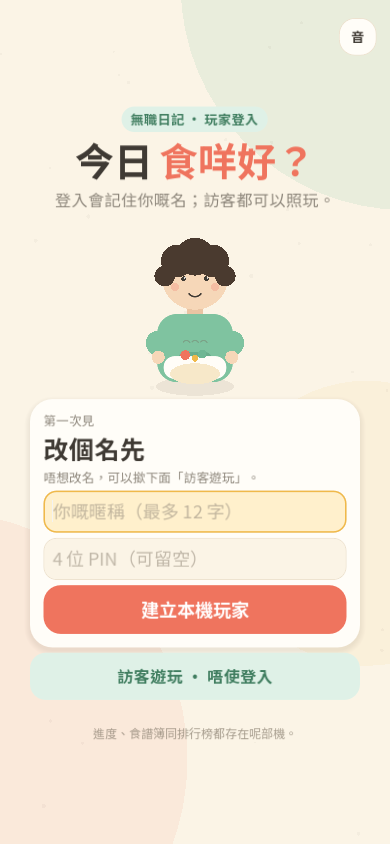

## 玩法

1. **每日預算**：基本 $60；有人讚好你嘅食譜會 +$5／日，持續 10 日。買餸煮飯不能超支。
2. **一日三餐**：早餐、午餐、晚餐各揀一道菜。32 道內建菜式 + 你同朋友創作嘅菜式。
3. **雪櫃存貨**：逐樣食材買入（容量 12 件），跨日保存；煮飯時先用雪櫃存貨。材料不足會彈出確認，問你是否同意補購；只會買缺少嘅材料。
4. **天氣浮動菜價**：每日價格有 ±8% 浮動；晴天蔬果平 8%、落雨蔬果貴 12%，再加每日兩款 -30% 特價。
5. **六種煮法**：煎、炸、炆、燉、焗、蒸；每道菜有自己嘅煮法，每種煮法有唔同操作同小遊戲。
6. **自創食譜**：用 1–3 樣材料創作、命名、揀煮法，加入食譜簿；可以用分享碼或線上朋友食譜分享。朋友讚好會變成人氣預算獎勵。
7. **自由創作**：揀三餐時，餐牌最上面有「自由創作」；即場揀材料同煮法，完成後即時生成菜式圖，直接煮嚟食。
8. **日結算**：計算營養、熱量、身體變化、儲起幾多錢，再給一句聽日貼士。三餐食齊後可以補貨再撳「今日完結」。
9. **第 7 日身體報告**：S / A / B / C / D 評級，並進入排行榜（本機 + 線上每日挑戰）。

> 為咗唔會卡死，煮飯時會預留最平白飯嘅錢；如果某道菜會令你冇錢食下一餐，卡上會顯示「要留 $X 畀下一餐」。

沒有 HP、沒有破產、沒有 game over；輸贏只看你七日後的身體，以及荷包剩幾多。

| 標題（登入後） | 主畫面（每日挑戰） |
| --- | --- |
|  | 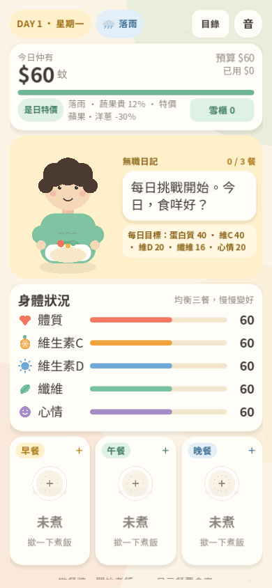 |

| 揀菜（自由創作喺最上面） | 雪櫃補貨 |
| --- | --- |
| 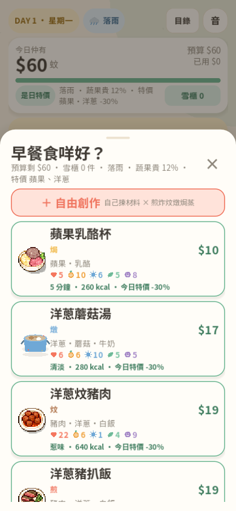 | 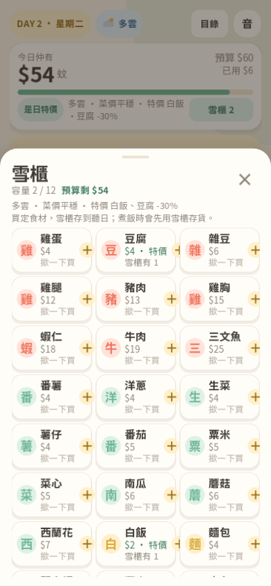 |

| 日結算 | 七日報告 |
| --- | --- |
| 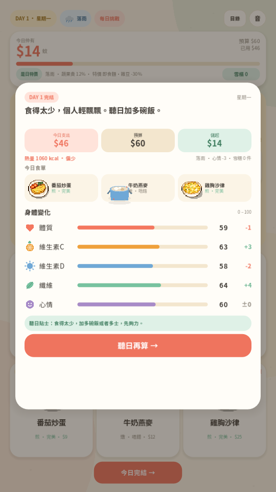 | 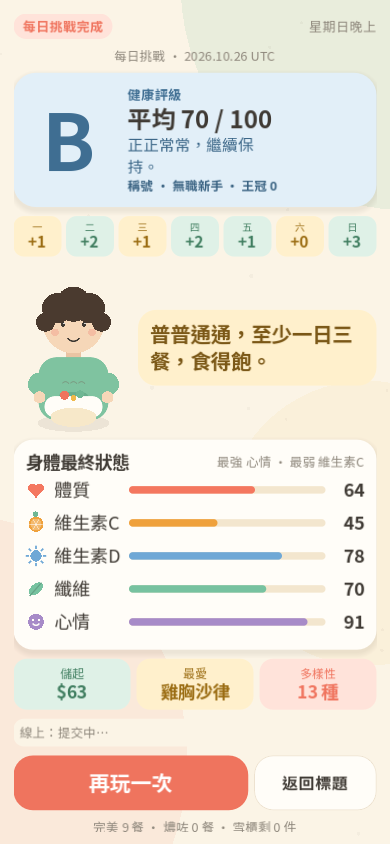 |

## 登入、訪客與目錄

- 第一次開遊戲會先見登入頁：輸入暱稱（最多 12 字），可選 4 位 PIN；也可以直接「訪客遊玩」。
- 本機暱稱同 PIN 存在 `user://profile.json`，不需要上網、不需要 Cloudflare 帳戶。
- 有 PIN 的話，下次開遊戲要輸入 PIN；冇 PIN 就一撳即入。忘記 PIN 可以用「用其他名／建立新玩家」覆蓋本機檔案。
- 標題畫面會顯示「玩家 · 名稱」或「訪客 · 休閒玩」，可以隨時撳「切換／登入」。
- 遊戲主畫面右上角有 **「目錄」**：自動存檔之後返標題，再撳「繼續上次」就可以返去原本進度。
- 訪客都可以完整遊玩、存檔、創作、分享；只是標題會標示訪客。

## Pixel food art（第一版）

`Desktop\food` 嘅 32×32 pixel art 已經接入遊戲：

- 102 張圖已複製到 `assets/pixel_food/`，總共只增加約 **114 KB** pck 大小。
- `manifest.json` 將 **19 道內建菜式**對應到合適圖片；其餘菜式自動 fallback 去原本 `FoodArt`。
- 顯示用 nearest-neighbor 放大，保持 pixel art 銳利；燶咗會加暗及燒焦斑。
- 已接入：主畫面三餐卡、揀菜卡、煮飯畫面、完美結果、日結算、食譜簿、分享畫面。
- 自由創作／自創食譜暫時未有專屬圖，會用 fallback；下一步會做「煮法底座 + 食材 sprite」compositor。

| 揀菜（pixel icon + fallback） | 已煮菜式卡 |
| --- | --- |
|  | 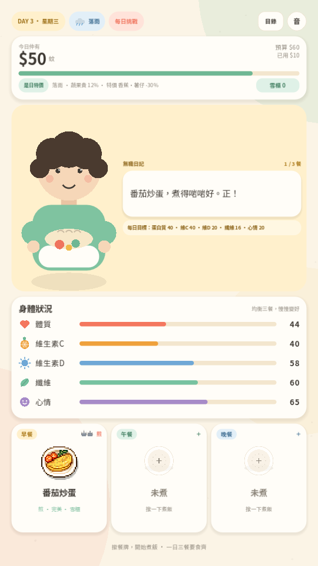 |

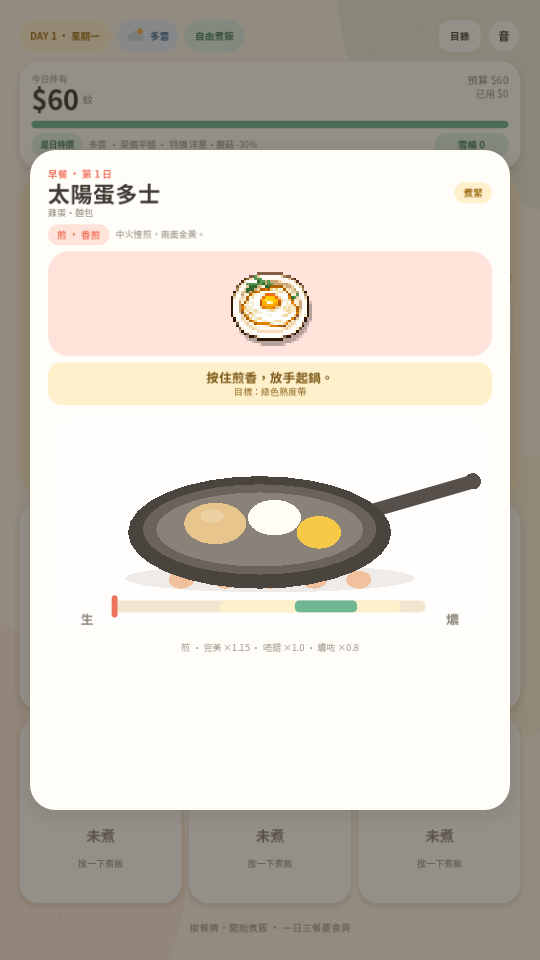

### 檔案與流程

- 原始圖：`C:\Users\user\Desktop\food`（唔會改動）。
- 匯入：`python tools\import_pixel_food.py`，會複製圖片、驗證 32×32、產生 `assets/pixel_food/manifest.json` 與 `MAPPING.md`。
- 對應表：`tools/import_pixel_food.py` 內嘅 `RECIPE_IMAGES`。改完再跑一次即可。
- 顯示層：`scripts/dish_art.gd`，有圖用圖，冇圖用 `FoodArt`。
- 之後如要換成 96×96／128×128 主視覺，只需保持 `manifest.json` 同檔名，或更新 mapping。

> 目前係第一版：部分菜式（例如番茄炒蛋、咖喱雞、三文魚、拉麵、沙律、炸雞、炆豬肉）已經有 pixel art；湯、粥、白飯、部分海鮮仍然用 fallback，所以會見到兩種畫風並存。

## 食物圖鑑、王冠、成就與稱號

標題畫面新增 **「食物圖鑑 · 成就 · 稱號」**。呢個系統會跨局累積，存在 `user://food_book.json`，唔會影響每日挑戰嘅市場種子。

### 王冠
同一款菜累積食夠指定次數就會升級：

| 次數 | 王冠 |
| ---: | --- |
| 3 | 銅冠 |
| 10 | 銀冠 |
| 25 | 金冠 |
| 50 | 彩虹冠 |

王冠會顯示喺揀菜卡、三餐卡、圖鑑同結算；煮完飯第一次達成新王冠會有提示。

### 成就
目前有 14 個成就，包括：
- 初次下廚、煮 10／50／100 餐
- 完美火候、10 次完美
- 焦香風味（煮燶）
- 食過 10 款／全部 32 款內建菜
- 第一個王冠、5 款／15 款菜有王冠
- 自家製（自由創作／自創食譜）
- 完成一局七日挑戰

### 稱號
王冠總數會解鎖稱號，可以喺圖鑑內自由選擇：

| 王冠總數 | 稱號 |
| ---: | --- |
| 0 | 無職新手 |
| 3 | 街坊食客 |
| 8 | 廚房常客 |
| 15 | 家常料理人 |
| 25 | 雪櫃管理員 |
| 40 | 無職食神 |
| 60 | 傳奇飯桶 |

已選稱號會顯示喺標題畫面同七日報告。

| 食物圖鑑 | 成就 |
| --- | --- |
| 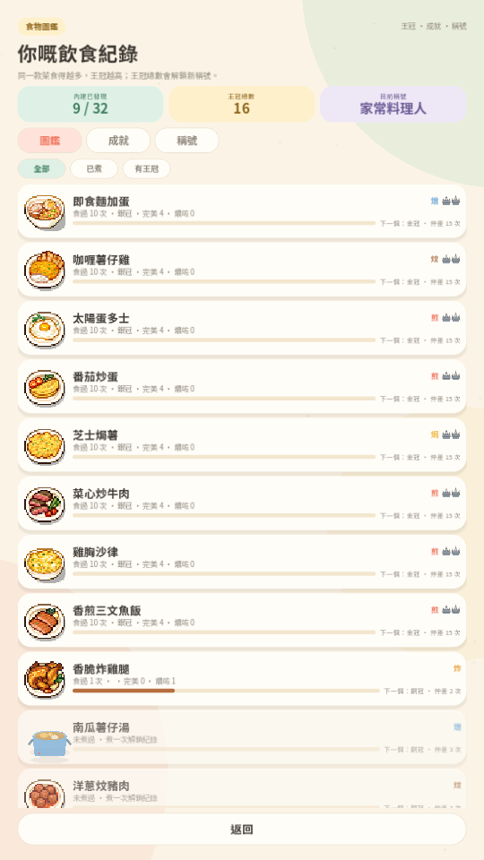 | 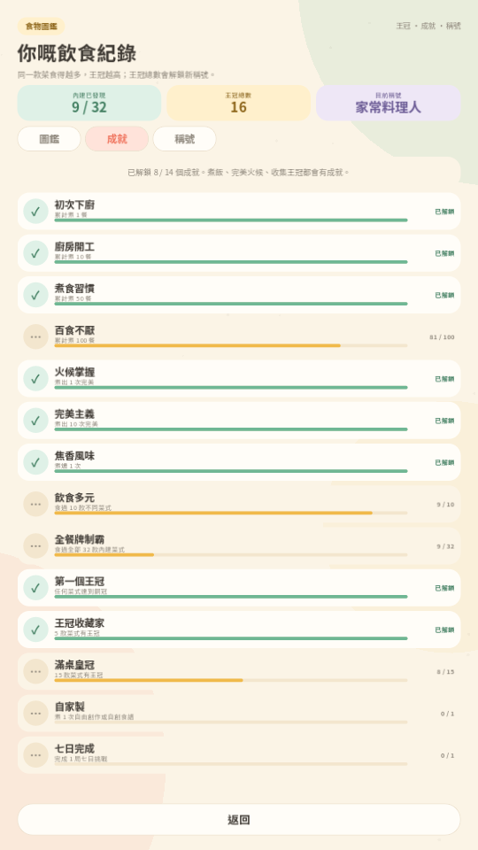 |

| 稱號 | 新解鎖提示 |
| --- | --- |
| 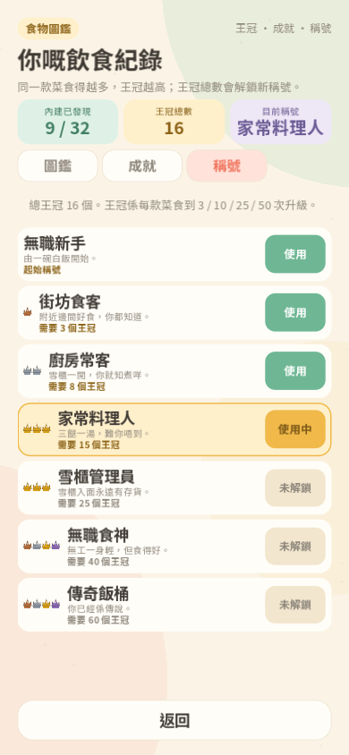 | 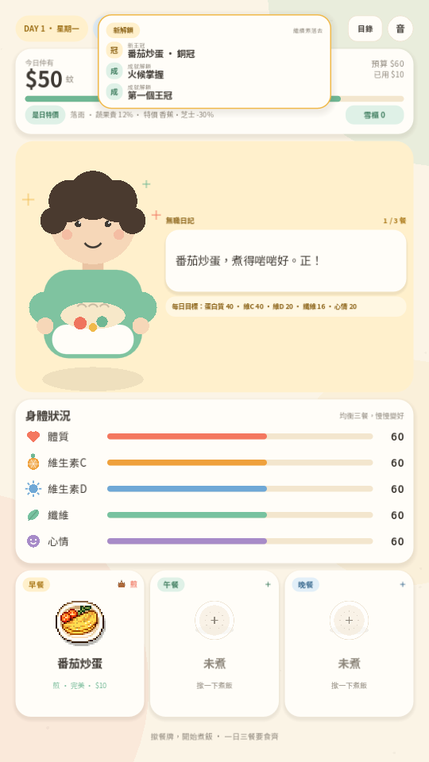 |

## 自創食譜、分享與點讚

- 食譜簿可以創作新菜式：改名（最多 12 字）、揀 1–3 樣材料、揀 **煎／炸／炆／燉／焗／蒸** 煮法；營養由材料自動加總。
- 新菜式會即時加入你嘅揀菜清單，同內建菜式一樣要用雪櫃材料、計預算、玩對應煮法小遊戲。
- **分享碼**：`EAT1:...`（會連煮法一齊分享），朋友可以貼上匯入，完全離線都用得。
- **線上朋友食譜**：發佈後其他玩家可以看到、加入、讚好；只會顯示匿名資料。
- **讚好獎勵**：自己發佈嘅食譜被讚好，下次同步時會收到人氣預算 **+$5／日 × 10 日**；多個讚好會累積日數（上限 90 日）。
- 離線／API 未連線：照樣可以創作、用分享碼、玩本機；只是讚好不會通知對方。

| 創作新食譜（可揀煮法） | 食譜簿 |
| --- | --- |
| 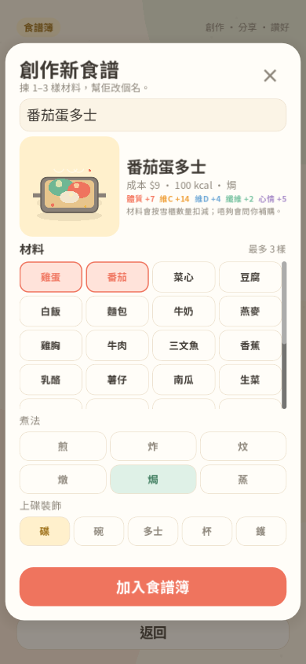 | 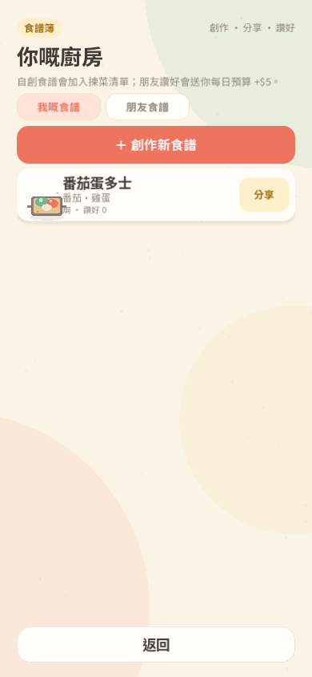 |

| 朋友食譜 + 讚好 | 分享碼 |
| --- | --- |
| 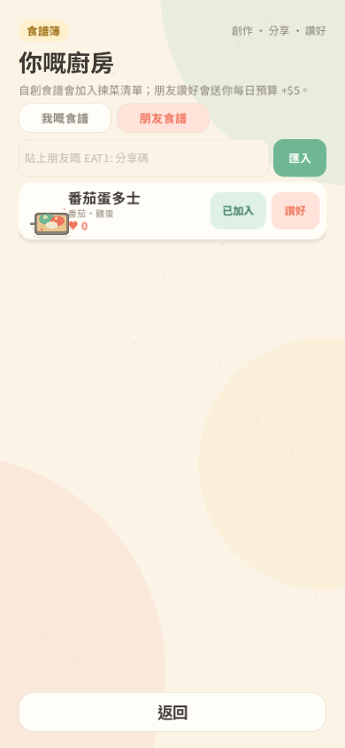 | 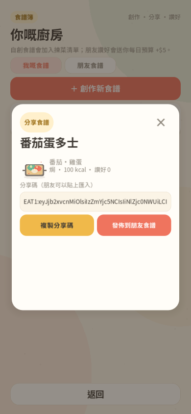 |

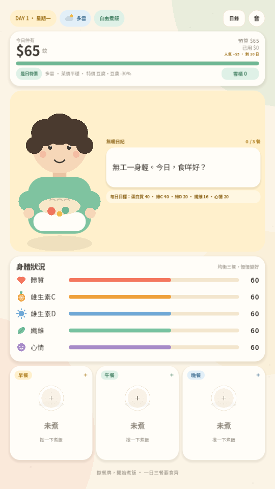

## 自由創作（直接加入三餐）

- 揀早餐／午餐／晚餐時，餐牌最上面會有 **「＋ 自由創作」**。
- 即場揀 1–3 樣材料、六種煮法其中一種；可以改名，亦可以留空自動命名（例如「清蒸雞蛋番茄」）。
- 會即時預覽材料費、補購後剩額、營養同 **程式生成菜式圖**。
- 如果雪櫃唔夠料，照樣會彈出補購確認；同意後才買缺少嘅材料。
- 自由創作嘅菜式只屬於當前呢一局，會跟存檔保存，但**不會自動加入食譜簿**；想永久保存，可以用「食譜簿 → 創作新食譜」。
- 菜式圖完全由材料顏色 + 煮法即時畫出：鑊、炸鍋、砂鍋、湯鍋、焗盤、蒸籠各有不同外觀，離線都用得。

| 自由創作 | 即時生成菜式圖 |
| --- | --- |
| 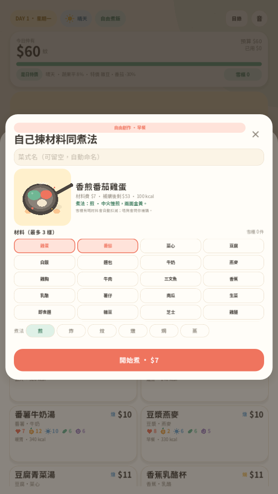 | 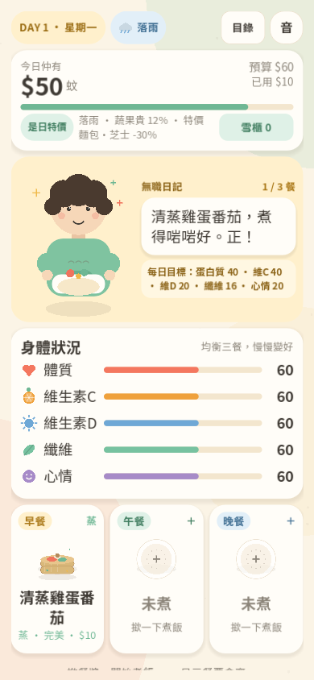 |

## 六種煮法與小遊戲

每道菜都有專屬煮法；同一個煮法會用同一個小遊戲，但菜式圖、材料、數值會跟住食材變化。

| 煮法 | 操作 | 小遊戲 |
| --- | --- | --- |
| **煎** | 按住煎香，放手起鍋 | 按住升溫，喺綠色熟度帶放手 |
| **炸** | 三件輪流起鍋 | 三件炸物各自有金黃圈，撳準時機逐件起鍋 |
| **炆** | 拖住火候 | 左右拖火焰，保持喺移動中嘅慢火帶 |
| **燉** | 跟住材料卡次序 | 材料卡有 1／2／3 次序數字，逐張撳 |
| **焗** | 較溫度再入爐 | 拖旋鈕較到 180°C，再撳焗爐 |
| **蒸** | 捉蒸氣節奏 | 蒸氣升到頂部綠帶時撳，連續三次 |

- 每個小遊戲上方都有一條 **大字指示 bar**，寫明操作同目標；遊戲內只保留必要標籤，避免文字同圖重疊。
- 燉湯材料卡會直接顯示食材名（例如南瓜／薯仔／牛奶）同永久 1／2／3 次序，唔需要死記。

- 評分同樣是 **完美 ×1.15 / 唔錯 ×1.0 / 燶咗 ×0.8**；小遊戲表現會直接影響營養保留。
- 滑鼠、觸控、鍵盤都支援；煮緊飯時沒有「返回」，要完成呢一餐才可以離開。

| 煎 | 炸 |
| --- | --- |
|  | 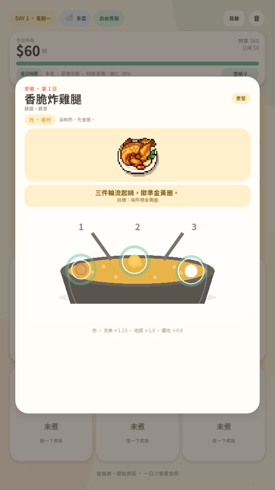 |

| 炆 | 燉 |
| --- | --- |
| 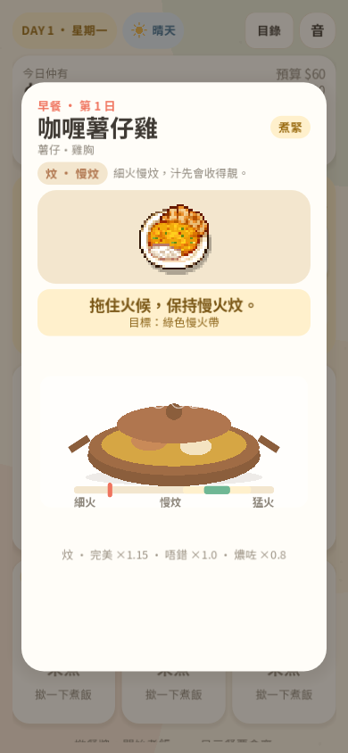 | 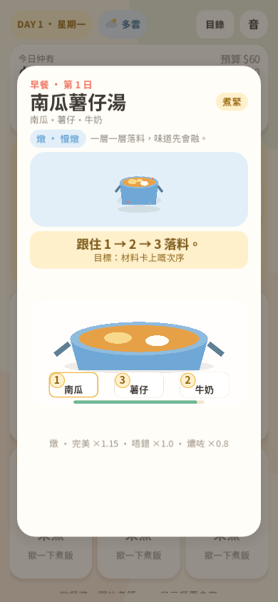 |

| 焗 | 蒸 |
| --- | --- |
| 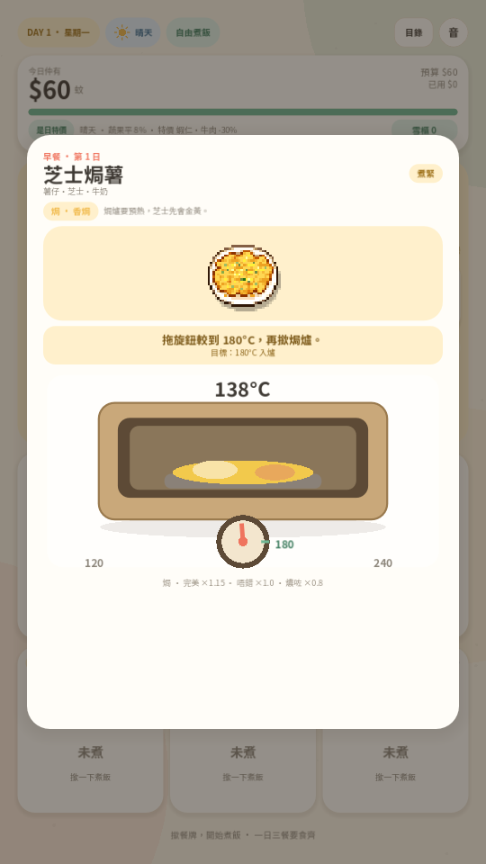 | 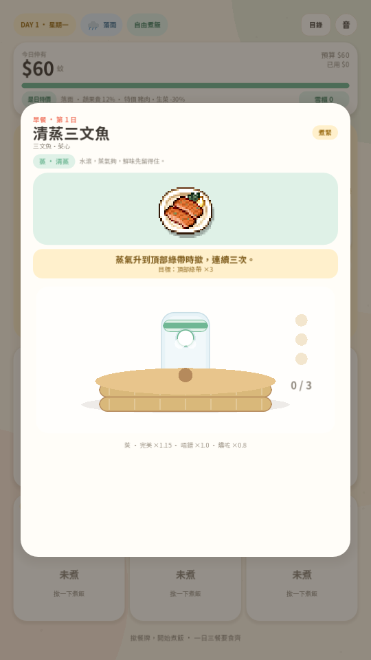 |

### 每日挑戰與自由煮飯

- **每日挑戰**：用 **UTC 日期**做種子（例如 `2026.10.25`），所有玩家同一日會遇到完全一樣的天氣、特價與市場。可以無限重玩，今日最佳會顯示在標題畫面。
- **自由煮飯**：隨機種子，隨便玩。
- **繼續上次**：每次煮飯、補貨、進入下一日都會自動存檔；再開遊戲可以繼續。完成一局後存檔會清除。
- 存檔與本機排行榜都存在 `user://`（Web 版是 IndexedDB），只在這部機。

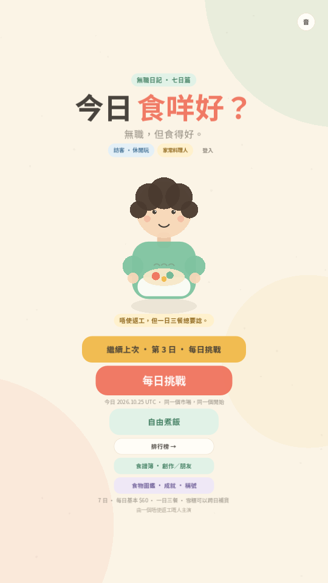

## 五項身體指數

全部是 **0–100 的遊戲單位**，不是醫療數據。每次日結算會根據當日總攝取量與目標比較。

| 指數 | 每日目標 | 主要來源 | 太低時 |
| --- | ---: | --- | --- |
| 體質 | 40 | 蛋白質（蛋、豆腐、雞、牛、魚、蝦） | 個人冇力、肌肉流失 |
| 維生素 C | 40 | 番茄、菜心、生菜、西蘭花、橙、水果 | 皮膚乾、抵抗力差 |
| 維生素 D | 20 | 三文魚、牛奶、芝士、太陽 | 成日留喺屋企，骨頭弱 |
| 纖維 | 16 | 菜、燕麥、雜豆、南瓜、番薯 | 腸胃唔舒服 |
| 心情 | 20 | 好味、多樣化、完美火候 | 食乜都冇癮 |

- 每日營養比例越接近目標越好；超出目標會慢慢加，長期不足會扣。
- 心情會受「食厭」影響：同一道菜本週每食多一次，心情加成 ×0.82、×0.64……最低 ×0.4。
- 一日食三款不同菜式有額外心情加成。
- 熱量低過 1150 kcal 會令體質打八折；高過 2700 kcal 會有少少負擔。
- 天氣：晴天維 D +2、心情 +2；落雨心情 -3。

## 煮法評分

| 評語 | 營養 | 心情 |
| --- | ---: | ---: |
| 完美 | ×1.15 | ×1.15 |
| 唔錯 | ×1.00 | ×1.00 |
| 燶咗 | ×0.80 | ×0.70 |

每個小遊戲都會計一個 0–1 表現分：夠準就是完美，中段是唔錯，太早／太遲／次序錯就會燶。小遊戲速度唔會隨日數瘋狂加快，整體仍然是休閒節奏。

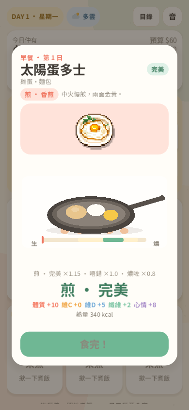

## 買餸、雪櫃與預算

- 每道菜的價錢 = 未從雪櫃取用的食材價錢總和；雪櫃已有的食材會自動扣减，所以卡上可能顯示 `$0` 和「雪櫃齊料」。
- 每款食材有 **每日 ±8% 浮動**；天氣再影響蔬果價：晴天 -8%、落雨 +12%、多雲平穩。另有每日兩款 **-30% 特價**。
- 基本每日預算 $60；如果最近收到讚好，會變成 **$65**，持續 10 日（可累積）。
- 雪櫃容量 **12 件**；用剩的錢會變成 **儲蓄**，用剩的食材會留在雪櫃，下一日繼續用。
- **材料不足會確認**：揀一道雪櫃唔齊料嘅菜，會列出缺少材料、補購費用和補購後剩額；同意才會買，取消會留喺餐牌。
- 為免卡死，系統會預留最平白飯嘅錢；唔夠就會顯示「要留 $X 畀下一餐」，而唔係靜靜雞超支。
- 完成三餐後可以繼續補貨，然後才撳「今日完結」；補貨的錢會計入當日支出，減低儲蓄，但食材會留到下日。

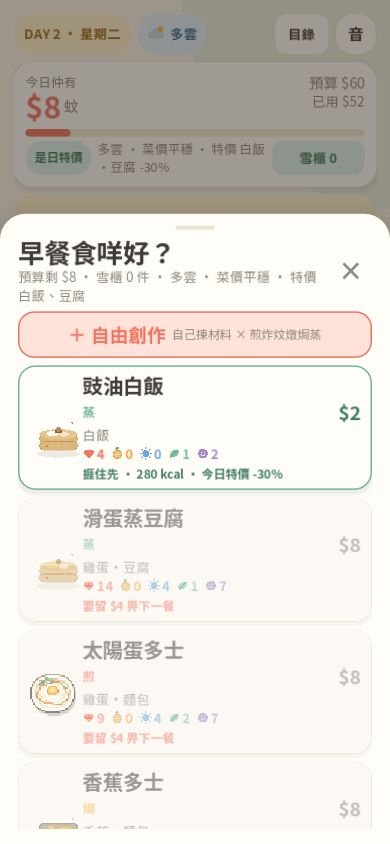

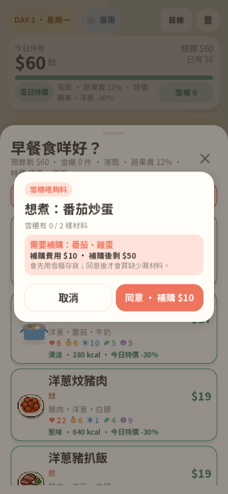

## 操作

| 動作 | 滑鼠／觸控 | 鍵盤 |
| --- | --- | --- |
| 登入／建立本機玩家 | 輸入暱稱、PIN，撳「建立」 | Enter |
| 訪客遊玩 | 撳「訪客遊玩」 | — |
| 每日挑戰／開始 | 撳「每日挑戰」 | Enter / Space |
| 繼續上次 | 撳「繼續上次」 | Enter / Space（有存檔時） |
| 自由煮飯 | 撳「自由煮飯」 | — |
| 返回目錄 | 主畫面右上角「目錄」 | — |
| 切換玩家 | 標題「切換／登入」 | — |
| 食物圖鑑／成就／稱號 | 標題「食物圖鑑 · 成就 · 稱號」 | — |
| 選擇稱號 | 圖鑑 → 稱號 → 「使用」 | — |
| 揀餐 | 撳早餐／午餐／晚餐卡 | — |
| 揀菜 | 撳菜式卡 | — |
| 自由創作 | 餐牌最上面「＋ 自由創作」 | — |
| 開雪櫃 | 撳預算行的「雪櫃 N」 | — |
| 煎 | 按住煎香，放手 | 按住 Space / Enter，放手 |
| 炸 | 逐件撳金黃圈 | 1 / 2 / 3 |
| 炆 | 左右拖火焰 | ← / → |
| 燉 | 按次序撳材料 | 1 / 2 / 3 |
| 焗 | 拖旋鈕，再撳焗爐 | ← / →，Enter |
| 蒸 | 蒸氣到頂時撳三下 | Space / Enter |
| 關閉餐牌／雪櫃／自由創作 | 撳 × 或背景 | Esc |
| 音效 | 右上角「音／靜」 | — |

## 存檔與排行榜

- 自動存檔：開始、每餐煮完、每次雪櫃補貨、進入下一日、撳「目錄」。
- 本機玩家檔案存在 `user://profile.json`；遊戲進度、食譜、排行榜仍然存在同一部機。
- 食物圖鑑、王冠、成就、已選稱號存在 `user://food_book.json`，跨局累積。
- 完成第 7 日後會清除進行中的存檔，並把成績寫入 **本機排行榜 Top 10**（平均健康分，之後比儲蓄）。
- 標題畫面「排行榜」有兩個 tab：**本機** 同 **線上挑戰**。
- 線上只計每日挑戰，匿名提交；每日每裝置只可提交一次。
- 每日挑戰係 **7 日 run**，以開始日 UTC 分組；線上提交期限 14 日，排行榜可以左右揀最近 14 日。
- 提交失敗／離線／API 掛咗：自動 fallback 本機，成績照樣保存；七日報告有「重試提交」。
- 每日挑戰用 UTC 日期；標題、日結算與線上榜都會標示 UTC。
- 自由創作嘅即時菜式會跟當前 run 存檔（`ephemeral_recipes`），但唔會寫入食譜簿。

| 本機 Top 10 | 線上每日 Top 10 |
| --- | --- |
| 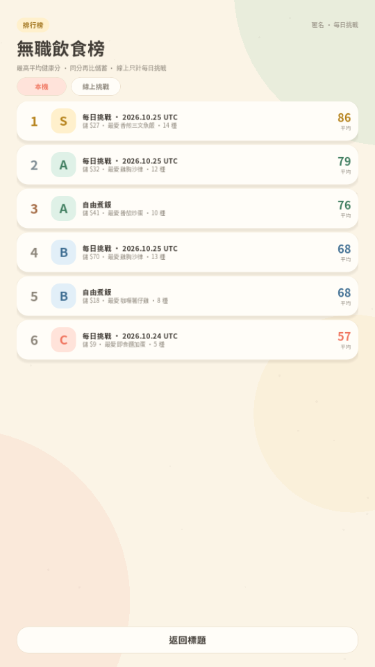 | 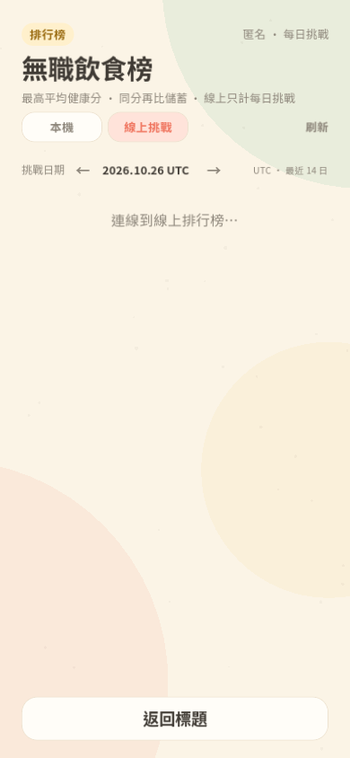 |

> 線上排行榜／朋友食譜用同一個 Cloudflare API Worker；遊戲本體喺另一個 Static Assets Worker。API 掛咗或離線時會自動 fallback 本機，分享碼仍然可以用。

## 線上排行榜（Cloudflare Workers + D1）

已部署：

- 遊戲（Worker Static Assets）：`https://what-to-eat-game.leechungkit2011.workers.dev/`
- 排行榜／食譜 API：`https://what-to-eat-leaderboard.leechungkit2011.workers.dev/api/`
- D1：`what-to-eat-leaderboard`（APAC）
- 代碼：`workers/leaderboard/`（API）＋ `workers/game/`（靜態遊戲）

> Godot Web 的 `index.wasm` 約 39.5 MB，超過 Cloudflare 靜態資源單檔 25 MiB 上限。遊戲 Worker 將 gzip 版 wasm 放在 `_wasm/index.wasm.gz`，收到 `/index.wasm` 時即時解壓回傳，所以不用改 Godot loader。

端點：

- `POST /api/leaderboard`：提交每日挑戰成績
- `GET /api/leaderboard?date=YYYYMMDD&limit=10`：指定日期 Top 10
- `POST /api/recipes`：發佈自創食譜（連 `method` 煮法）
- `GET /api/recipes?limit=20`：朋友食譜（匿名，回傳 `method`）
- `POST /api/recipes/:id/like`：讚好（每裝置每食譜一次、不可自讚）
- `GET /api/rewards?device_id=...`：自己食譜收到嘅總讚好，用嚟派人氣預算
- 匿名 device id、每日每裝置一次（`UNIQUE(device_id,date_key)`）
- 伺服器用 stats 重算平均分與 grade；限制數值範圍、body 4KB、IP 基本 rate limit
- 只回傳匿名排名，不公開 device id
- 只接受 UTC 今日起 **14 日內**提交（容許 7 日 run 跨日完成）
- 每日挑戰係一個 **7 日 run**，以開始日 UTC 做 seed；線上榜按開始日分組，排行榜可以左右揀最近 14 日

免費額度（2026）：Workers 100,000 requests／日、10ms CPU；D1 5M rows read／日、100k rows written／日、5GB。以呢個遊戲規模通常 **$0**。

本機測試：

```powershell
cd workers\leaderboard
npx wrangler d1 execute what-to-eat-leaderboard --local --file=./schema.sql
npx wrangler dev --local --port 8787
```

部署步驟、`wrangler.toml`、D1 database id、CORS 與 API 範例：見 [`workers/leaderboard/README.md`](workers/leaderboard/README.md)。

遊戲端 `config/online.cfg`（目前正式設定）：

```ini
[online]
; production Cloudflare Worker
endpoint="https://what-to-eat-leaderboard.leechungkit2011.workers.dev/api/leaderboard"
enabled=true
```

- Web 版會用呢個完整 Worker URL；Native 版亦會連線。
- 而家 Worker `ALLOWED_ORIGIN` 只准：`https://what-to-eat-game.leechungkit2011.workers.dev`、`http://127.0.0.1:8000`、`http://localhost:8000`。如果你搬去自訂網域，記得更新 `workers/leaderboard/wrangler.toml` 再 deploy。
- 如果你想改成同源（Pages + Worker route），可以將 endpoint 留空，Web 版會自動用 `window.location.origin + /api/leaderboard`。
- 改完 config 要重新 export Web build。

重新部署遊戲 + API：

```powershell
powershell -ExecutionPolicy Bypass -File tools\deploy_cloudflare.ps1
```

> 腳本會 build Web、更新 `workers/game/public`、gzip wasm，然後 deploy 兩個 Worker。

> 防刷係基本級：遊戲係 client-authoritative，改機／改 JS 仍然可以偽造成績；匿名裝置亦可重裝再刷。真正防作弊要 server-side replay 或簽名，成本高很多。


## 專案結構

```text
what_to_eat/
├─ main.tscn                    主場景（只有一個 Control）
├─ project.godot                720 × 1280、expand、gl_compatibility
├─ config/online.cfg             線上 API endpoint（留空 = 同源）
├─ workers/leaderboard/          Cloudflare Worker + D1 + 部署說明
├─ scripts/
│  ├─ main.gd                   流程、場景切換、存檔、每日挑戰、自由創作、開發用 tour
│  ├─ data.gd                   32 種食材、32 道內建菜、6 種煮法、營養目標、天氣
│  ├─ game_state.gd             純遊戲邏輯：預算、雪櫃、種子市場、結算、報告、即時菜式
│  ├─ profile_data.gd           本機暱稱 + PIN、訪客 session
│  ├─ save_data.gd              進行中存檔、本機 Top 10、匿名 device id
│  ├─ online.gd                 線上 API 客戶端（排行榜／食譜／讚好／獎勵）
│  ├─ recipe_book.gd            自創食譜、分享碼、喜愛數、人氣預算（autoload）
│  ├─ food_book.gd              食物圖鑑、王冠、成就、稱號（autoload）
│  ├─ collection_screen.gd      圖鑑／成就／稱號畫面
│  ├─ crown_badge.gd            王冠小圖示
│  ├─ unlock_toast.gd           新王冠／成就／稱號提示
│  ├─ recipe_studio.gd          創作食譜介面（材料 + 煮法 + 上碟）
│  ├─ recipe_book_screen.gd     食譜簿（我的／朋友／匯入）
│  ├─ share_dialog.gd           分享碼／發佈
│  ├─ buy_confirm.gd            材料不足補購確認
│  ├─ login_screen.gd           第一個畫面：本機登入／訪客
│  ├─ title_screen.gd           標題（玩家／每日挑戰／自由／繼續／排行榜／食譜簿）
│  ├─ home_screen.gd            主畫面（預算、雪櫃入口、角色、身體、三餐、目錄）
│  ├─ dish_picker.gd            菜式選擇 bottom sheet（自由創作 + 雪櫃覆蓋率）
│  ├─ free_cook_sheet.gd        自由創作：材料 + 煮法 + 即時預覽
│  ├─ fridge_sheet.gd           雪櫃補貨 bottom sheet
│  ├─ cook_screen.gd            煮飯畫面：按煮法載入對應小遊戲
│  ├─ cook_method_game.gd       煎／炸／炆／燉／焗／蒸 六種互動
│  ├─ day_summary.gd            日結算
│  ├─ end_screen.gd             七日報告 + 一週節奏 + 線上提交
│  ├─ leaderboard_screen.gd     排行榜（本機／線上挑戰）
│  ├─ meal_card.gd / stat_row.gd
│  ├─ character_art.gd          自繪角色（呼吸、眨眼、完美煮食會跳）
│  ├─ food_art.gd               自繪菜式圖（fallback：鑊／炸鍋／砂鍋／湯鍋／焗盤／蒸籠）
│  ├─ dish_art.gd               pixel-food 圖片 + FoodArt fallback
│  ├─ stat_icon.gd / weather_art.gd / backdrop.gd
│  ├─ ui_kit.gd                 顏色、字型、圓角卡片、按鈕
│  └─ sfx.gd                    即時合成音效（無外部音檔）
├─ config/online.cfg            線上 API endpoint（production Worker）
├─ workers/leaderboard/         Cloudflare Worker + D1 schema + 部署說明
├─ workers/game/                遊戲靜態 Worker（gzip wasm 特例）
├─ tests/
│  ├─ test_state.tscn           475 項邏輯測試
│  ├─ test_save.tscn            51 項存檔／排行榜／本機玩家／圖鑑測試
│  ├─ sim.tscn                  平衡分析：暴力搜尋每日最佳組合
│  ├─ font_check.tscn           檢查匯入字型有冇缺字
│  └─ seed_*.tscn               開發用：造存檔／排行榜紀錄
├─ tools/
│  ├─ build_web.ps1             字型 → icon → import → Web 匯出 → PWA patch
│  ├─ deploy_cloudflare.ps1     build → prepare assets → deploy game + API
│  ├─ prepare_game_assets.py    複製 Web build、gzip wasm、加 .gdignore
│  ├─ import_pixel_food.py      匯入 32×32 pixel food + 產生 manifest/mapping
│  ├─ build_font.py             子集化 Noto Sans TC
│  ├─ build_icons.py            生成 PWA icons
│  ├─ patch_pwa.py              修正 manifest 中文名、portrait、192/maskable icon、離線 cache
│  └─ serve.ps1                 本地靜態伺服器
├─ assets/fonts/                Regular / Bold 子集 + OFL
├─ assets/pwa/                  PWA icons
├─ assets/pixel_food/           32×32 pixel food + manifest + mapping
├─ docs/                        README 截圖
└─ build/web/                   已匯出的 HTML5 版本
```

## 執行

```powershell
# 直接執行
& "C:\Users\user\Desktop\Godot_v4.7.2-stable_win64.exe" --path .

# 邏輯測試（475 checks）
& "C:\Users\user\Desktop\Godot_v4.7.2-stable_win64_console.exe" --headless --path . res://tests/test_state.tscn

# 存檔／排行榜／本機玩家／圖鑑測試（51 checks）
& "C:\Users\user\Desktop\Godot_v4.7.2-stable_win64_console.exe" --headless --path . res://tests/test_save.tscn

# 平衡分析
& "C:\Users\user\Desktop\Godot_v4.7.2-stable_win64_console.exe" --headless --path . res://tests/sim.tscn
```

### HTML5 / PWA

```powershell
# 字型、PWA icons、匯入、匯出、manifest 修正
powershell -ExecutionPolicy Bypass -File tools\build_web.ps1

# 本地試玩（一定要經 HTTP，唔好直接開 index.html）
powershell -ExecutionPolicy Bypass -File tools\serve.ps1
# 開 http://127.0.0.1:8000/
```

- 已有一個可直接部署的靜態版本在 `build/web/`，另有 `build/web.zip`。
- 匯出使用 **單線程、無 GDExtension**，不需要 COOP/COEP header。
- `index.wasm` 約 39.5 MB，未壓縮；正式上線請開 gzip / brotli，通常可壓到 10 MB 左右。
- **PWA 已啟用**：manifest、service worker、144/180/192/512/maskable icons、standalone、portrait。第一次載入會把 wasm/pck 放入 Cache Storage，之後可以 **離線開 game**。
- PWA 安裝需要 **HTTPS**（localhost 例外）；在 Chrome/Edge 可「安裝」，iOS Safari 可「加到主畫面」。
- 更新版本時 service worker 會用新 cache version，舊 cache 會自動清除。

### 字型

- 只嵌入遊戲實際用到的中文字，Regular + Bold 各約 300 KB。
- `tools/build_web.ps1` 每次都會先跑 `build_font.py`，避免新增 UI 文字後 Web 版缺字（桌面版有系統字型 fallback，較難察覺）。
- 字型來源：Noto Sans TC Variable（SIL Open Font License，見 `assets/fonts/OFL.txt`）。重新生成需要 `fonttools` 和 `C:\Windows\Fonts\NotoSansTC-VF.ttf`。

## 數值調整

| 項目 | 位置 | 目前值 |
| --- | --- | ---: |
| 一局日數 | `game_state.gd` `DAYS` | 7 |
| 每日預算 | `MealGameState.BUDGET` + `extra_budget` | 基本 $60；人氣 +$5 |
| 雪櫃容量 | `game_state.gd` `FRIDGE_CAPACITY` | 12 |
| 市場浮動 | `game_state.gd` `_start_day` | 每日 ±8%；晴蔬果 -8%、雨 +12% |
| 補購確認 | `buy_confirm.gd` / `main.gd` | 缺少材料時先確認 |
| 人氣獎勵 | `recipe_book.gd` | 每個讚好 +$5 × 10 日，上限 90 日 |
| 自創食譜 | `data.gd` / `recipe_book.gd` | 1–3 樣材料、12 字名、6 種煮法 |
| 王冠 | `food_book.gd` `CROWN_THRESHOLDS` | 3 / 10 / 25 / 50 次 |
| 稱號 | `food_book.gd` `TITLES` | 0 / 3 / 8 / 15 / 25 / 40 / 60 王冠 |
| 成就 | `food_book.gd` `ACHIEVEMENTS` | 14 個 |
| 自由創作 | `free_cook_sheet.gd` | 即時菜式，跟 run 存檔、不進食譜簿 |
| 煮法 | `data.gd` `COOK_METHODS` | 煎／炸／炆／燉／焗／蒸 |
| 本機玩家 | `profile_data.gd` | 暱稱 12 字、可選 4 位 PIN |
| 初始五項 | `game_state.gd` `_init` | 60 |
| 每日目標 | `data.gd` `STATS[...].target` | 40 / 40 / 20 / 16 / 20 |
| 每日增減 | `game_state.gd` `settle_day` | `clamp(round((ratio-1)×18), -10, +6)` |
| 完美／唔錯／燶 | `data.gd` `QUALITY` | 1.15 / 1.0 / 0.8（心情 1.15 / 1.0 / 0.7） |
| 食厭懲罰 | `game_state.gd` `repeat_penalty` | 每次 -0.18，最低 0.4 |
| 多樣化心情 | `game_state.gd` `totals_preview` | 每款不同菜 +2 |
| 特價 | `game_state.gd` `_start_day` | 2 款食材 -30%，由日期種子決定 |
| 評級門檻 | `game_state.gd` `report` | S ≥ 82、A ≥ 72、B ≥ 62、C ≥ 52，其餘 D |
| 本機榜 | `save_data.gd` | Top 10，先比平均分再比儲蓄 |

`tests/sim.tscn` 會用暴力搜尋示範：每日最均衡的組合通常要花到 $50–60；全「唔錯」火候、七日均衡，平均約 76–79（A）。亂食或全燶可以跌到 D。

## 設計筆記

- **無經濟壓力**：沒有租金、破產、飢餓死亡；預算只是一日一次的取捨遊戲。玩家不會「輸」，只會見到身體變差。
- **雪櫃是策略層**：趁特價入貨、跨日使用，令「買餸」和「煮飯」之間多一層計劃，但唔會強迫玩家管理複雜庫存。
- **每日挑戰**：UTC 日期種子令全球玩家同一日有同一個市場；線上排行榜用匿名 device id + 每日一次提交，本機排行榜永遠做 fallback。
- **健康不是道德審判**：五項指數是遊戲單位，鼓勵均衡與多樣，不提供真實營養建議。
- **超休閒視覺**：奶油色底、圓角卡、珊瑚紅／薄荷綠／日光黃；角色、UI、圖示全部用 `_draw` 畫，菜式圖用 pixel-food 圖片 + `FoodArt` fallback。
- **資料與畫面分離**：所有數值在 `data.gd` / `game_state.gd`，UI 只負責呈現，方便加菜或改平衡。
- **桌面與手機**：720 闊舞台 + `expand`，手機填滿、桌面置中；所有互動都是大按鈕，支援滑鼠、觸控、Space / Enter。

## 已知限制 / 下一步

- **線上排行榜／食譜已部署**：遊戲 `https://what-to-eat-game.leechungkit2011.workers.dev/`、API `https://what-to-eat-leaderboard.leechungkit2011.workers.dev/api/`。CORS 已收窄到遊戲網域（另加 localhost 開發）。遊戲係 client-authoritative，基本防刷不等於完全防作弊。
- 自創食譜嘅營養由材料加總，可能有偏強組合；目前冇 server-side 營養審核。
- 線上食譜未有內容審核／舉報機制。
- 目前 32 道內建菜、32 種食材、6 種煮法、7 日。食物圖鑑／成就／稱號存在本機，未有雲端同步；換裝置或清除瀏覽器資料會失去紀錄；圖鑑跟裝置，不跟暱稱，同一部機不同 profile 會共用。32×32 pixel food 已接入 19 道菜；其他菜式、自由創作、自創食譜仍用 fallback，會見到兩種畫風並存。下一步建議生成 32 張 128×128 專屬菜式圖，再做「煮法底座 + 食材 sprite」compositor。
- 本機登入只是暱稱 + 4 位 PIN，不是高安全性帳戶；同一部機的存檔仍然共用。清除瀏覽器資料會一併清除 profile、存檔與食譜。
- 自由創作菜式暫時未有專屬圖，會用 `FoodArt` fallback；不同材料會影響色塊與構圖，未會畫出非常寫實的食材。
- 小遊戲以滑鼠／觸控／鍵盤為主；極慢裝置可能影響節奏遊戲體驗。
- 沒有背景音樂；音效是即時合成。
- PWA 第一次仍需下載 39.5MB wasm；可再研究壓縮、分流與較細的 engine build。
- 可加手機震動、分享每日挑戰成績、每日任務、賽季排行榜。

## Credits

- 引擎：Godot 4.7.2
- 字型：Noto Sans TC（SIL Open Font License 1.1），經 `fonttools` 子集化
- Pixel food icons：使用者提供，使用 ComfyUI + Qwen 生成；使用前請確認所用模型授權
- 美術、UI、音效：本專案內程式生成（菜式圖另有 pixel-food 圖片）
